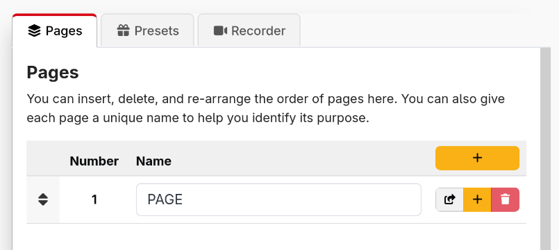

Since Companion v3.5, it has been possible to have as many or few pages in Companion as you would like.

For new installations, Companion starts off with 1 page, but you can add as many as you need, some users have hundreds others only a handful.

:::tip
It is a good idea to name each of your pages, to help you identify them easily
:::

:::danger
Be careful when reordering pages or inserting pages into the middle. Any references to page numbers will not be automatically updated, so you can break your existing buttons.
:::

## Page variables

Each page can have its own variables. These work just like the
[local variables](../variables.md#local-variables) of a button, but are shared by every button on the page.
They are a good fit for values which belong to the page as a whole, such as which camera a page of buttons is
controlling, or the name of the person a page is set up for.

Page variables are managed in the **Page Variables** tab next to the button grid, and always belong to the page
currently shown in the grid. They can be any of the local variable types: a **User Value**, an **Evaluate
Expression**, or a **Feedback**.

On any button on that page, use a page variable with `$(page:name)`. For example, a page variable called
`presenter` is used as `$(page:presenter)`.

Page variables can be changed from anywhere, including from another page or a trigger, using the internal
actions **Page Variable: Set value**, **Page Variable: Reset to startup value** and **Page Variable: Write
current value to startup value**. These actions ask which page to change, so you can for example use one
button to choose what a whole other page controls. An action can also store its result into a page variable,
see [Storing an action's result](./creating/actions.md#storing-an-actions-result).

:::note
Triggers don't belong to a page, so they can't read `$(page:...)` variables directly. They can still change
page variables with the actions above.
:::

Page variables are included when you export and import a page.
