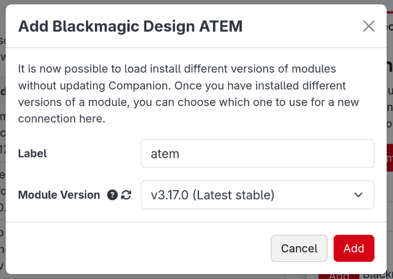
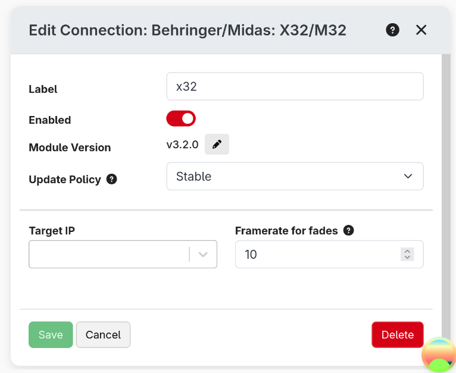
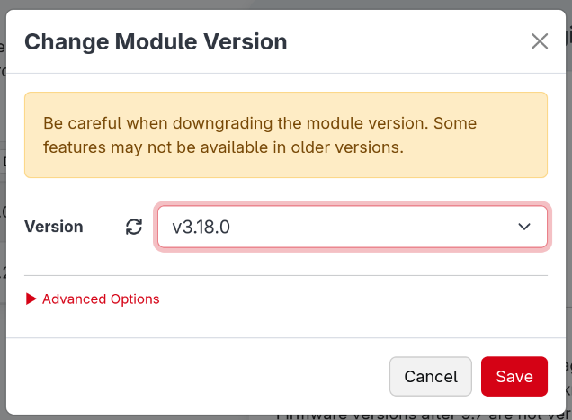

From the Connections tab, you can add, configure and remove devices. You can also see the status of a connection, as well as other information about it in the table.

In 4.0, the modules have been moved to be downloadable plugins. This allows you to get updates to modules much quicker and easier than before. As part of this, we do not distribute modules anymore with Companion.

:::note
When updating Companion, your modules are no longer automatically updated for you. You will need to manually update them when on this page when you are ready.

Similarly, when importing a config, you should make sure appropriate versions of the module are selected and are installed using this page.
:::

If you are on an offline system, the list of the right will likely be empty and you will need to download and import the offline module bundle from the website. You can read more about this in the [Modules section](./modules.md)

## Adding a connection

If you have not already installed a version of the module you need, you may need to toggle the list to show those which are available, not just those which are installed.

1.  Add a new device, by scrolling through the list or through a search.
2.  Choose the specific device you want to add.
3.  Fill out the dialog to choose the version of the module to use. In this, you can always choose any installed versions, and if you are able to access the store it will offer to install the latest version.  
    
4.  Enter the connection information for device. Save the changes.

Your new device should now show in the Connections tab along with all the other devices you want to control.
Each device needs to be a separate connection. If you have two separate Barco E2, you need to add both of them as separate connections.

:::note
If you have multiple connections using the same module, they can now each be running different versions of the module.
:::

Once you have added your connections, you can reorder or filter them in the table. In the rightmost column, you can expand a list of buttons:

- **Help** will open that module's help information. This is also possible in the list on the right before adding a connection.
- **Known Issues** will take you to the GitHub page for the module. You should report any bugs you encounter with the module here, or any feature requests for missing functionality. Tip: The more detail you give on a bug or feature request, the more likely it is to be handled quickly.
- **Variables** will show a list of all the variables that a connection provides. These can be used in various places either explained later on.
- **View Logs** is a debug log for the module. When reporting a bug, module developers may want extra information from here to help figure out the bug. To most users this will not be interesting.

A full list of supported devices can also be found on the website. [Companion Module Support List](https://l.companion.free/q/5LT04sXCC)

## Collections

If you have a lot of connections, you can organise them into collections. Click **Create Collection** above the
connections table, give the collection a name, and then drag connections into it. Collections can also be placed
inside other collections.

Each collection has its own enable switch. Disabling a collection disables every connection inside it (including
those in collections inside it), which is handy for switching off many things at once. The
connections keep their own enabled setting, so they go back to how they were when the collection is enabled
again.

## Monitoring connections

Companion provides some internal variables to keep an eye on your connections:

| Variable                                        | Value                                                                     |
| ----------------------------------------------- | ------------------------------------------------------------------------- |
| `$(internal:instance_total)`                    | The number of connections                                                 |
| `$(internal:instance_oks)`                      | The number of connections which are OK                                    |
| `$(internal:instance_warns)`                    | The number of connections with a warning                                  |
| `$(internal:instance_errors)`                   | The number of connections with an error                                   |
| `$(internal:instance_disabled)`                 | The number of disabled connections                                        |
| `$(internal:connection_<label>_status)`         | The status of a connection: `good`, `warning`, `error` or `disabled`      |
| `$(internal:connection_collection_<id>_status)` | Whether a connection collection is enabled (`true`) or disabled (`false`) |

The collection status variables use an internal id for the collection rather than its name. The easiest way to
find the right one is to look in the **Internal** section of the [Variables page](./variables.md), where each is
described as **Connection Collection Status:** followed by the collection's name.

There are also internal feedbacks to show the status of a connection on a button.

## Configuring a connection

Once you have added a connection, you can click on it in the connection list to open its configuration in the right panel.

When the connection is enabled, you will be able to configure the module defined configuration.

Make sure to click Save when you are done, for your changes to be saved.

## Updating a connection

From the connection configuration panel, you can also update the version of the module being used.

Click the pencil icon next to the module version number to open the editor

This panel will offer the latest available version and any installed versions. Clicking save will restart the connection to apply the change

:::tip
You can install more versions of a module or uninstall versions from the [Modules page](./modules.md)
:::

## Deprecated modules

Sometimes a module, or a particular version of a module, is deprecated by its maintainers. This usually means it
is no longer being updated, or that a newer version or a different module should be used instead.

This is shown clearly:

- a yellow **Deprecated** or **Deprecated version** badge appears next to the module name in the connections
  list (hover over it to see why),
- a warning is shown at the top of the connection's configuration panel and in the module's help.

If a version is deprecated, update the connection to a newer version of the module as described above. If the
whole module is deprecated, look for an alternative module for your device.

This information comes from the module store, so it is only shown when Companion has been able to reach the
store.

In case you need it, you are able to force a connection to use a different module. This should not be needed for normal use, it is an escape hatch for edge cases that we haven't thought of.
