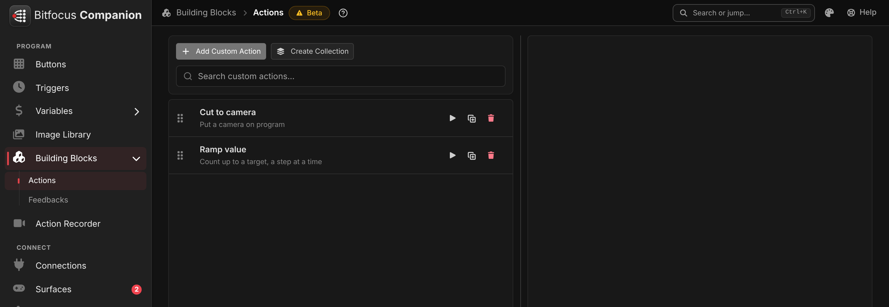
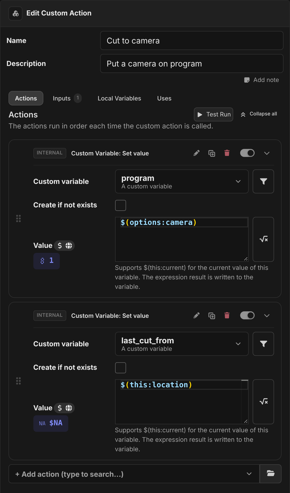
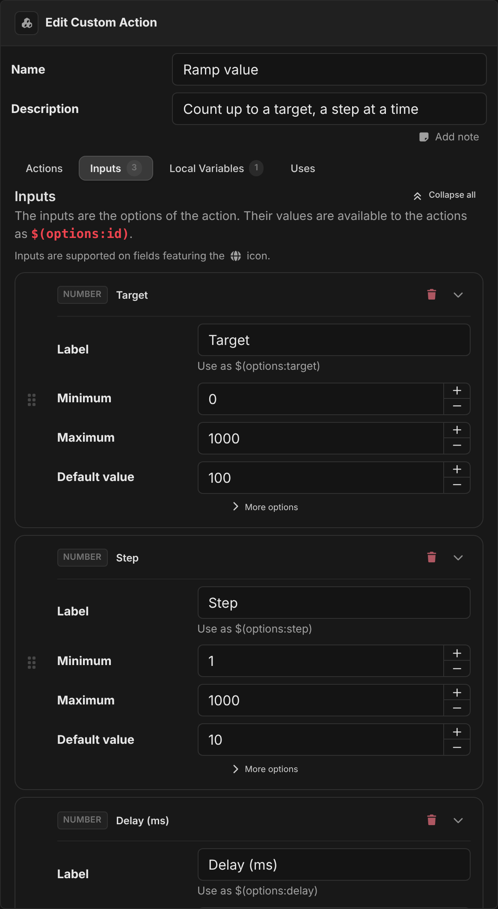
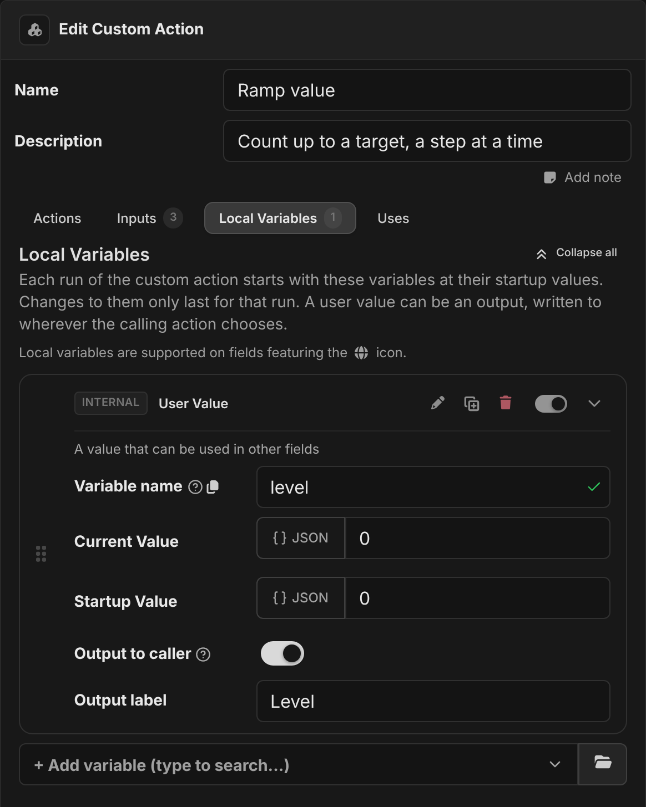
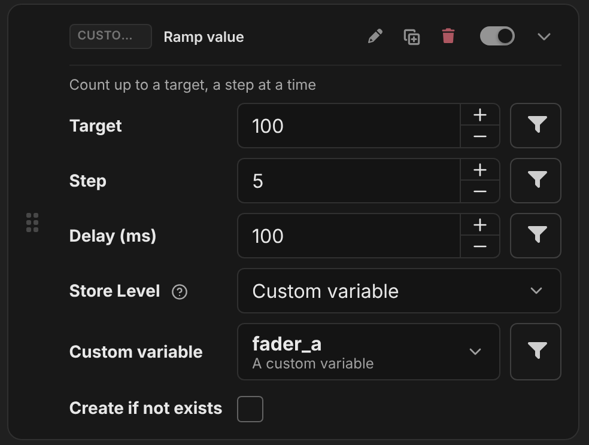
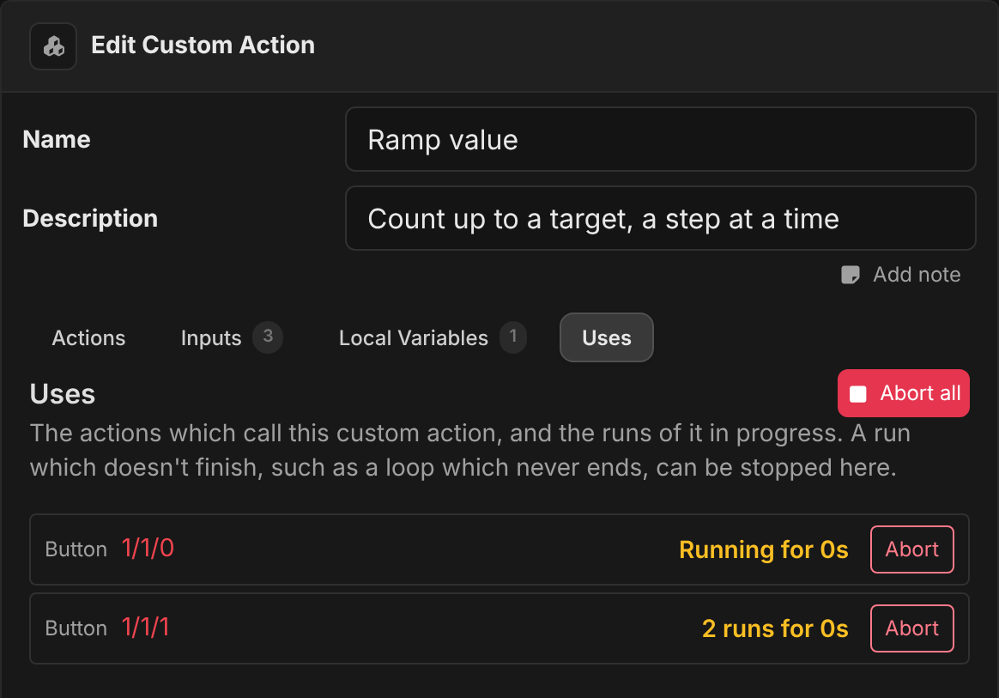
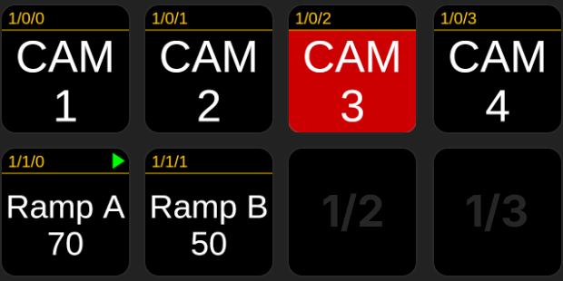
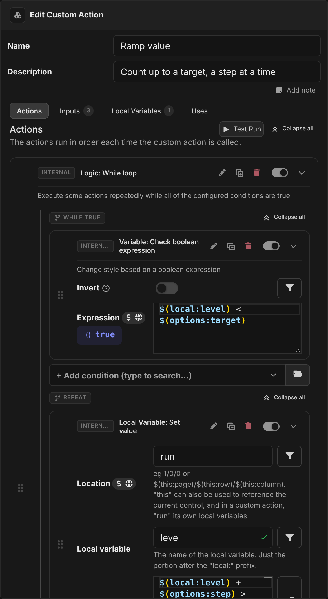

:::warning Beta
Custom actions are new and still in beta. The way they behave may change in future releases.
:::

A custom action is a list of actions that you build once and then use anywhere, just like any other action. You can give it **inputs**, so each place that uses it can change what it does, and **outputs**, so it can hand a result back.

Use them to keep a sequence that you repeat on many buttons or triggers in one place. When you need to change the sequence, you edit the custom action, and every button and trigger that uses it picks up the change.

You find custom actions under **Building Blocks → Actions** in the sidebar.



## Creating a custom action

Click **Add Custom Action**, then select it in the list to open the editor on the right. Give it a **Name** and a **Description**. These are what you see when you pick the action on a button, so make them clear.

The editor has four tabs:

- **Actions**: what the custom action does.
- **Inputs**: the options that each use of it can set.
- **Local Variables**: variables that only exist inside the custom action.
- **Uses**: everything that calls this custom action, and any runs that are in progress.

From the list, you can also test run, clone or delete a custom action. You can group custom actions into collections, like triggers and connections.



### Actions

Add actions here in the same way you add them to a button. Any action you can use on a button can go in a custom action, including the logic actions (**Logic: If**, **Logic: While loop**, …), connection actions, and other custom actions.

:::important Running order
The actions in a custom action follow the execution mode of the place that calls it, just as if they had been placed there directly. On a button, actions start together by default, so the actions inside a custom action called from a button also start together.

If the order matters, put the actions inside an **Action group** set to **Sequential**, or call the custom action from inside a sequential group.
:::

**Test Run** runs the actions straight away, using the default value of each input. There is no button behind a test run, so `$(this:page)`, `$(this:row)` and the other `$(this:…)` variables are empty. The value previews in the editor work the same way: in the screenshot above, `$(this:location)` previews as `$NA` because it only has a value when a button runs the action.

### Inputs

Inputs are the options that appear on the action when you add it to a button. Inside the custom action, you read the value with `$(options:<id>)`, where `<id>` is the id of the input.



You can use the same kinds of field that modules use: text, number, checkbox, dropdown, multi-select dropdown, colour, expression, and static text. Each input has a default value. The default is used when a caller hasn't set that input, for example when you add a new input after the custom action is already in use.

A few things to know:

- **Callers can use variables and expressions in inputs.** The value is worked out where the caller is, so `$(this:page)` in an input is the caller's page. Execution variables such as the delta of a rotary encoder work too.
- **An invalid value stops the action.** If a caller gives an input a value that isn't valid (a number out of range, for example), the custom action does not run, and an error is logged. Fix the value to make it run again.
- **Renaming an input keeps the values.** When you change the id of an input, the value each caller set for it comes along, and references to `$(options:<old id>)` inside the custom action are updated for you.
- **Removing an input discards its values.** The values that callers had set for it are dropped.

### Local variables

Local variables work like the [local variables on a button](./variables.md), but they belong to the custom action. Inside it, you read them with `$(local:<name>)`.



Each run of the custom action gets its **own** set of local variables. The run starts with each variable at its startup value, and anything the run changes only lasts until the end of that run. The next run starts fresh. See [How custom actions run](#how-custom-actions-run) for what this means in practice.

The type of local variable makes a difference:

| Local variable               | Its value inside a run                                                                                                                                                |
| ---------------------------- | --------------------------------------------------------------------------------------------------------------------------------------------------------------------- |
| **User Value**               | Starts at its **Startup Value**. The run can change it with the **Local Variable** actions. Only this type can be an output.                                          |
| **Expression**               | Calculated for the run, so it can use `$(options:…)`, other local variables, and any other variable.                                                                  |
| **Feedback** (from a module) | Comes from the connection, using the inputs of the caller. Each caller has its own subscription, so a feedback that uses `$(options:…)` follows that caller's inputs. |

To change a local variable during a run, use **Local Variable: Set value** with the **Location** set to `run`. This is the default inside a custom action.

The other local variable actions also work on a run, with some limits:

- **Reset to startup value** puts the variable back to its startup value for the rest of the run.
- **Write current value to startup value** is ignored. A run can't change the custom action itself.
- **Persist value** has no effect. Each run always starts from the startup value.

The **Current Value** shown in the editor is never changed by runs. It only shows what a run starts with.

:::note
Changing a local variable inside a run never changes a variable with the same name on the button that called it. To get a value back to the caller, use an [output](#outputs).
:::

### Outputs

An output lets a custom action hand a value back to whatever called it. Any **User Value** local variable can be an output. To make one, turn on **Output to caller** on the variable, and give it an **Output label** (see the `level` variable in the screenshot above).

Each output appears on the calling action as a **Store `<label>`** option. The caller chooses where the value goes: a custom variable, a local variable, or a page variable. You can use an expression to choose the target, and it is worked out where the caller is.



The output is written to the caller's target:

- once when the run starts, with the startup value
- again each time the run changes the variable

This means a custom action that runs for a while, such as a loop, can show its progress as it goes. The `Ramp value` example below does this.

Once a run is aborted, it no longer writes its outputs. When custom actions call each other, an output of an inner custom action can be stored in a local variable of the outer custom action, and then passed up as one of its outputs.

### Uses

The **Uses** tab lists every button, trigger and custom action that calls this custom action, along with any runs that are in progress and how long they have been running. Click a button's location to show its page.



A run that doesn't finish, such as a loop that never ends, can be stopped here. **Abort** stops the runs started by one caller, and **Abort all** stops every run of the custom action. Stopping a run doesn't stop the other actions on the button that called it.

## Using a custom action

A custom action shows up in the action picker under **Custom actions**, alongside the actions from your connections. You can add it to a button, a trigger, or another custom action. Set its inputs and outputs like any other action.

You can also jump straight to a custom action from the command palette (<kbd>Ctrl</kbd>+<kbd>K</kbd>).

A custom action can call other custom actions, but it can never end up calling itself. You can't add a custom action to itself, and the picker hides any custom action that would call back to the one you are editing. If calls would still loop (after an import, for example), or nest more than 16 deep, the custom action shows a warning, and the call that would loop or go too deep does not run.

## How custom actions run

This section explains what is shared and what is separate when the same custom action is used in many places, or run many times at once.

There are three layers:

1. **The custom action**: what you edit. It is a definition. It never runs on its own, apart from a test run.
2. **One copy for each action that calls it**: every action that calls the custom action, on any button, trigger or other custom action, holds a live copy of it, set up with that caller's inputs. This copy keeps the module feedbacks and local variables inside the custom action subscribed and up to date, so their values are ready the moment it runs.
3. **One copy for each run**: each time the action runs, the custom action is copied again just for that run, starting from the values of the caller's copy. This copy is thrown away when the run ends.

```
Custom action "Ramp value"                  (the definition you edit)
 ├── Button 1/1/0 → copy (Target 100, Step 5)
 │      ├── run #1   own inputs, own local variables
 │      └── run #2   own inputs, own local variables
 └── Button 1/1/1 → copy (Target 50, Step 10)
        └── run #1   own inputs, own local variables
```

### What a run sees

| Variable                                             | Inside a run                                                                                                                                                                                                                                                                                                             |
| ---------------------------------------------------- | ------------------------------------------------------------------------------------------------------------------------------------------------------------------------------------------------------------------------------------------------------------------------------------------------------------------------ |
| `$(options:…)`                                       | The caller's inputs, worked out **once, when the run starts**. If a variable used in an input changes during the run, the run keeps the value it started with. The next run uses the new value.                                                                                                                          |
| `$(local:…)`                                         | The run's **own** local variables. Every run starts from the startup values, and no other run can see or change them.                                                                                                                                                                                                    |
| `$(this:…)`                                          | The **control that called it**: the button (or trigger) where the run started. These stay live, so if the button's page is renumbered during a run, the run sees the new number, just like the button's own actions would. When custom actions call each other, `$(this:…)` is still the button at the top of the chain. |
| `$(page:…)`                                          | The page variables of the caller's page.                                                                                                                                                                                                                                                                                 |
| `$(custom:…)`, `$(internal:…)`, connection variables | Shared, as everywhere else. They are read live, so a loop can watch one change while it runs.                                                                                                                                                                                                                            |

The same rules apply to the **Location** option of the local variable actions:

- `run` is the run's own local variables.
- `this` is the control that called it, so a custom action can set a local variable on the calling button directly, using `this` with the button variable's name.
- A location such as `1/2/3` is that button, as normal.

### Running more than once at the same time

Every run is independent. If you press a button again while its custom action is still running (in a loop, or waiting on a **Wait** action), a **second run starts alongside the first**. It does not restart or replace the first run. Each run counts with its own local variables, from the startup value.

Both runs write their outputs to the same place, so whichever run writes last wins. If you only ever want one run at a time, guard the custom action yourself. For example, use a custom variable as a "busy" flag that the custom action checks at the start and clears at the end, or use **Abort** to stop the earlier run first.

Two different buttons that use the same custom action never share anything, apart from the outputs and other variables they choose to write to. Each has its own inputs, its own copy, and its own runs.

### When runs stop

A run stops when:

- it finishes its actions
- the caller is aborted, for example with the **Actions: Abort button runs** action
- it is aborted from the [Uses](#uses) tab
- the custom action is deleted
- the calling button is moved or swapped to another location. Copying a button leaves the original's run going.

If you edit a custom action while it is running, runs that are already in progress keep going with the version they started with. Everything that calls it switches to the new version straight away, and the next run uses it.

### Triggers and other controls without a location

A trigger has no place on the button grid, so in a custom action called from a trigger, `$(this:page)`, `$(this:row)` and `$(this:column)` are empty. The location `this` refers to the trigger.

### Connections

Module feedbacks used inside a custom action (as conditions of a **Logic: If**, for example, or as local variables) are subscribed once for each caller, with that caller's inputs. If many callers end up with exactly the same options, they share a subscription with the connection. If they differ, the connection is asked for each one.

A run with the same inputs as its caller's copy starts with the values that copy already has, so it doesn't have to wait for the connection to report them again.

## Examples

These examples only use internal actions, so you can try them without any connections. They use the custom variables `program`, `last_cut_from`, `fader_a` and `fader_b`.



### Cut to camera

This is a simple custom action. It takes one input, and sets a few variables from it. Four buttons each call it with a different camera number.

- **Input**: `camera` (number, 1–8, default 1)
- **Actions**:
  - **Custom Variable: Set value**. Set `program` to the expression `$(options:camera)`.
  - **Custom Variable: Set value**. Set `last_cut_from` to the expression `$(this:location)`.

Button `CAM 3` calls it with **Camera** set to `3`. When you press it, `program` becomes `3` and `last_cut_from` becomes `1/0/2`. `$(this:location)` is the location of the button that was pressed, not of the custom action.

Pair it with the [Camera is live](./custom-feedbacks.md#example-camera-is-live) custom feedback to light up whichever button is on program.

### Ramp value

This one runs for a while. It counts up to a target, a step at a time, and reports its progress through an output.

- **Inputs**: `target` (number, default 100), `step` (number, default 10), `delay` (number, default 100)
- **Local variable**: `level`, a **User Value** with a startup value of `0`, with **Output to caller** turned on and the label `Level`
- **Actions**:
  - **Logic: While loop**, with the condition **Variable: Check boolean expression** `$(local:level) < $(options:target)`
    - **Local Variable: Set value**. Location `run`, name `level`, with the expression:
      ```
      $(local:level) + $(options:step) > $(options:target) ? $(options:target) : $(local:level) + $(options:step)
      ```
    - **Internal: Wait** for `$(options:delay)` ms



`Ramp A` calls it with **Target** `100` and **Step** `5`, and stores **Level** in `fader_a`. `Ramp B` calls it with **Target** `50` and **Step** `10`, and stores **Level** in `fader_b`. The buttons show `$(custom:fader_a)` and `$(custom:fader_b)`, which count up as the runs progress. Both can run at once without affecting each other, because each run has its own `level`.

Things to try, to see the behaviour described above:

- Press `Ramp B` twice quickly. The **Uses** tab shows two runs for that button. Both start from `0`, and both write to `fader_b`.
- Set **Target** on a button to an expression using a custom variable, and change that variable during a ramp. The ramp in progress keeps its original target, and the next press uses the new one.
- Put `$(custom:stop) != true` in the loop condition as well, and set `stop` to `true` during a ramp. Unlike inputs, other variables are read live, so the loop stops at its next check.
