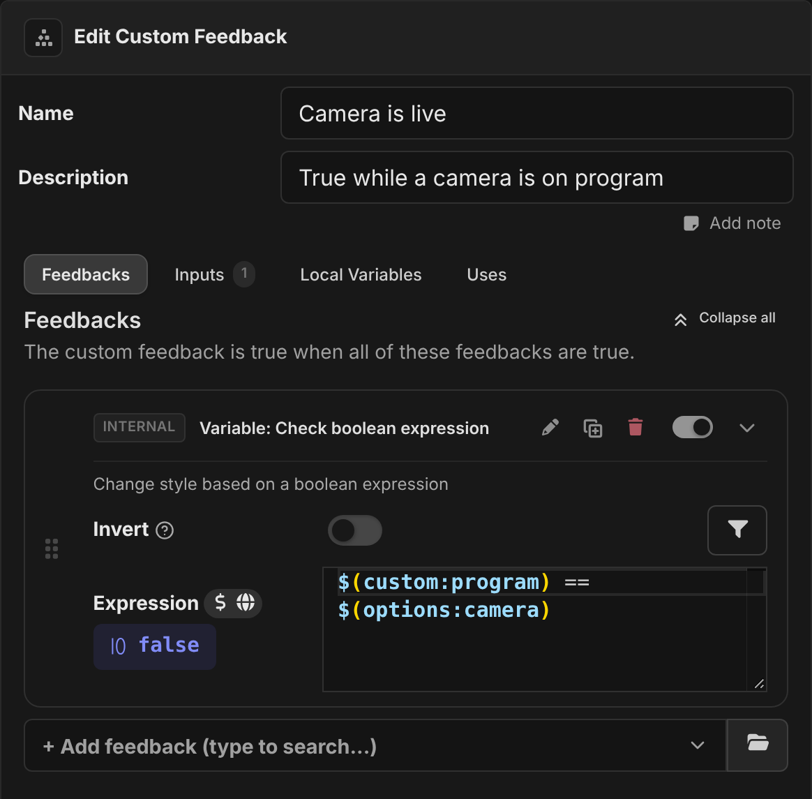
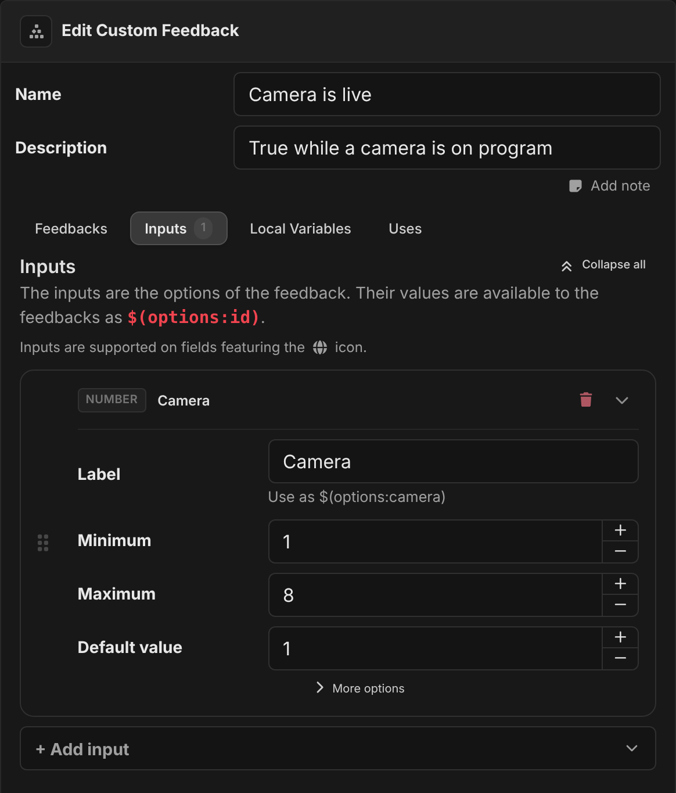
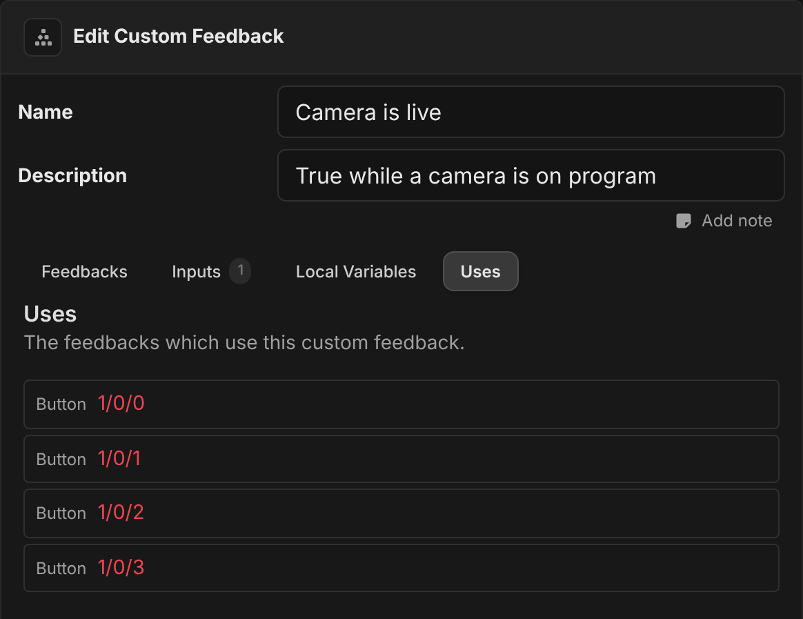
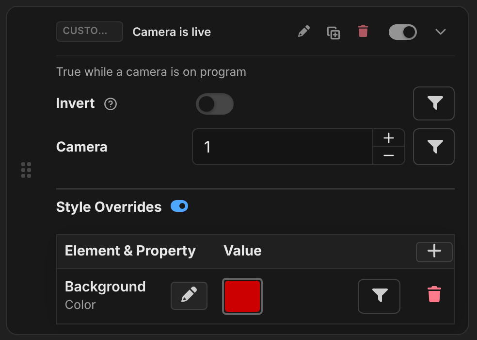
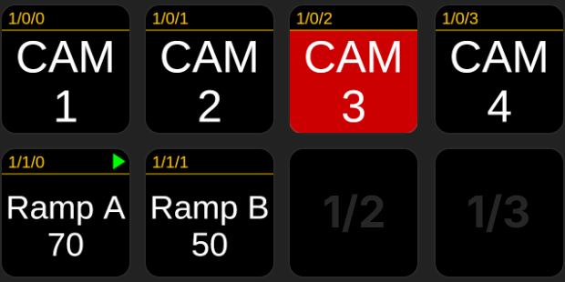

:::warning Beta
Custom feedbacks are new and still in beta. The way they behave may change in future releases.
:::

A custom feedback is a boolean (true/false) feedback that you build from other feedbacks, and then use anywhere, just like any other feedback. You can give it **inputs**, so each place that uses it can change what it checks.

Use them when the same check appears on many buttons. For example, "this camera is on program", or "this channel is muted and the show is live". You write the check once, and each button only sets its inputs and chooses its own style.

Custom feedbacks are the partner of [custom actions](./custom-actions.md). You find them under **Building Blocks → Feedbacks** in the sidebar.

## Creating a custom feedback

Click **Add Custom Feedback**, then select it in the list to open the editor. Give it a **Name** and a **Description**. These are what you see when you pick the feedback on a button.

The editor has four tabs: **Feedbacks**, **Inputs**, **Local Variables** and **Uses**.

### Feedbacks

The custom feedback is **true when all of its feedbacks are true**. You can use any boolean feedback, from Companion or from a connection, including other custom feedbacks.

- To check that **any** of several conditions is true, put them inside a **Logic: OR** feedback.
- A custom feedback with no feedbacks is always false.
- A disabled feedback inside it is ignored.

The custom feedback itself has no style. Each button that uses it sets its own style overrides, the same as for any other boolean feedback.

### Inputs

Inputs are the options that appear on the feedback when you add it to a button. Inside the custom feedback, you read them with `$(options:<id>)`. They work in the same way as the [inputs of a custom action](./custom-actions.md#inputs). For example, a missing input uses its default, and renaming an input keeps the values that each use has set.

If a use gives an input a value that isn't valid, that use of the feedback is false until the value is fixed.

### Local variables

Local variables let you work out a value once and use it in several of the feedbacks, with `$(local:<name>)`. **Each use of the custom feedback has its own copy of them**, which sees the inputs of that use. So an **Expression** local variable such as `$(options:channel) + 100` has a different value on each button.

A custom feedback has no actions, so nothing can change a **User Value** local variable inside it. A User Value always holds its startup value.

### Uses

The **Uses** tab lists every button, trigger, custom action and custom feedback that uses this custom feedback.

## Using a custom feedback

A custom feedback shows up in the feedback picker under **Custom feedbacks**. You can use it anywhere a boolean feedback can go:

- in a button's **Feedbacks**, with style overrides
- as a trigger **Condition**
- as the condition of a **Logic: If** or **Logic: While loop** action, including inside a custom action
- inside another custom feedback

You can **Invert** it like any other boolean feedback.

A custom feedback can't use itself, directly or through others. The picker hides any custom feedback that would. If uses still loop (after an import, for example), the loop is reported and that use is false.

## How custom feedbacks work

Like a custom action, a custom feedback is a definition. **Every feedback that uses it holds its own live copy**, set up with that use's inputs. That copy decides whether that one use is true or false. Unlike a custom action, nothing "runs", so there is no extra copy for each run. The copy simply follows the variables and connections it depends on.

| Variable                                             | Inside a custom feedback                                                                |
| ---------------------------------------------------- | --------------------------------------------------------------------------------------- |
| `$(options:…)`                                       | The inputs of **that use**. When a variable used in an input changes, the copy updates. |
| `$(local:…)`                                         | That use's own local variables, calculated from its inputs.                             |
| `$(this:…)`                                          | The control that uses it, such as the button.                                           |
| `$(custom:…)`, `$(internal:…)`, connection variables | Shared, as everywhere else.                                                             |

Some things to know:

- **Connection feedbacks are subscribed once for each use**, with that use's inputs. Uses with the same options share a subscription with the connection.
- **As a condition of an action**, such as in a **Logic: If**, the custom feedback is checked at the moment the action runs. Its inputs and internal feedbacks see what the actions before it have just done. Connection feedbacks inside it can only give the most recent value the connection reported.
- **Editing the custom feedback** updates every use straight away.
- **Deleting the custom feedback** makes every use of it false.

## Example: Camera is live

This feedback lights up the button for whichever camera is on program. It goes with the [Cut to camera](./custom-actions.md#cut-to-camera) custom action.

- **Input**: `camera` (number, 1–8, default 1)
- **Feedbacks**: **Variable: Check boolean expression** with `$(custom:program) == $(options:camera)`

Each of the buttons `CAM 1` to `CAM 4` uses **Camera is live** with **Camera** set to its own number, and a style override that turns the background red. When `program` is `3`, only `CAM 3`'s copy is true:

To check the camera that the button is for, rather than a fixed number, you could give the input an expression such as `$(local:camera)`, and give each button a local variable `camera`. The custom feedback then follows that button's variable.
