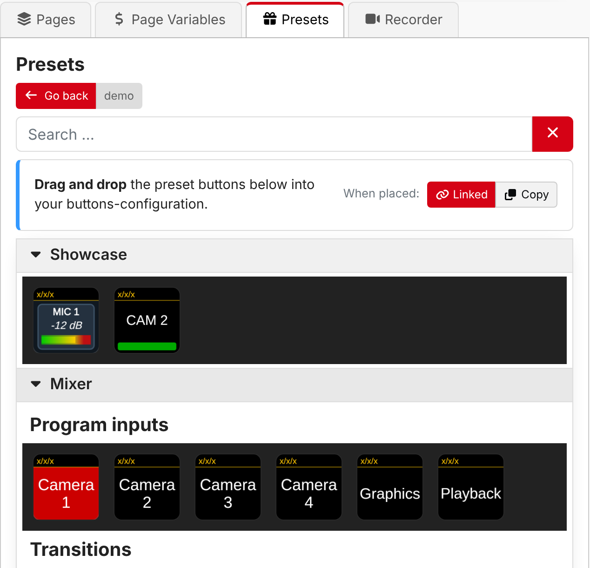
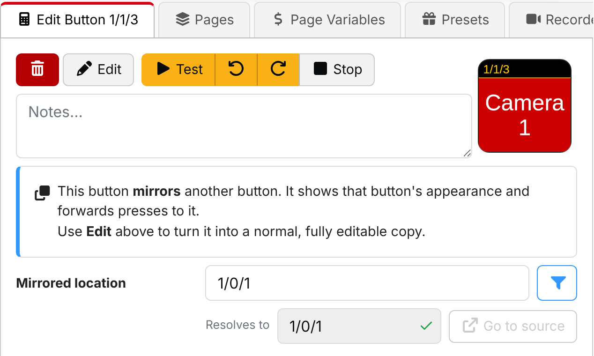
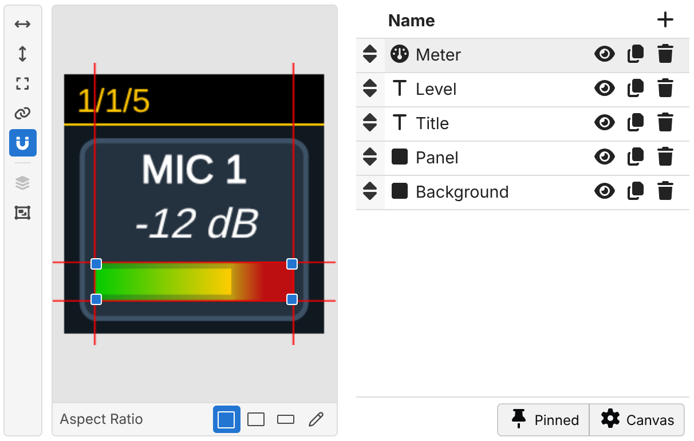
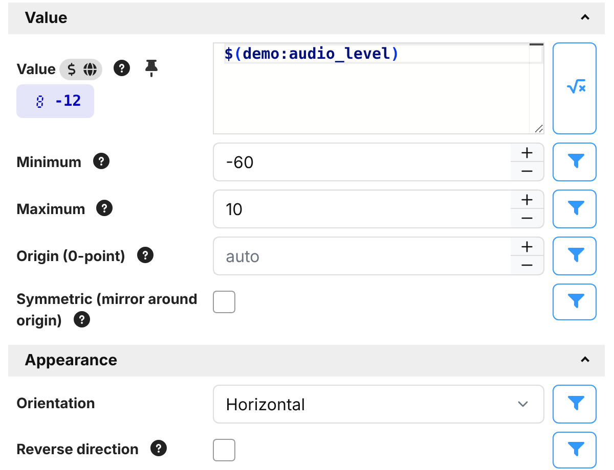
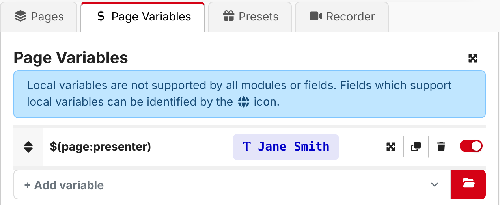
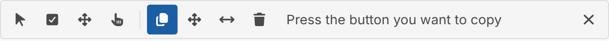
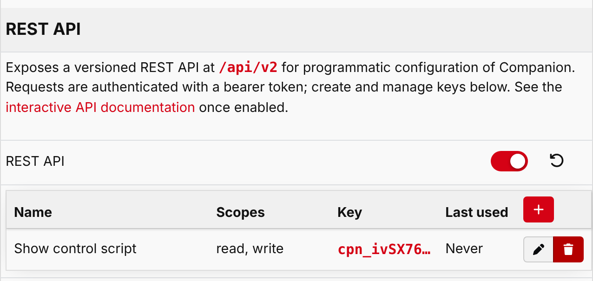

Companion 5.1 builds on the new graphics system from 5.0, making buttons quicker to design and easier to reuse. It
also adds page variables, a new REST API, and many smaller improvements throughout.

## Linked presets

Presets can now stay **linked** to the module that provided them. When the module updates a preset, for example
in a new version of the module, every button you placed from it updates too. You no longer need to delete and
re-place your preset buttons to pick up improvements.

Linked buttons work just like any other button, but their setup is managed by the preset. You can still switch
which connection they use, and change the values which make each button of a set different, such as which input a
switcher button selects. If you want to customise one further, click **Edit** to unlink it into a normal button.

Linked is now the default for modules which support it. Use the **When placed** toggle at the top of the Presets tab
to place a one-off copy instead, as in earlier versions.

Read more in the **Using presets** section of the user guide.

## Button references

A new **Button reference** button type mirrors another button: it looks exactly like it, and pressing it presses
the other button. Use it to have the same button in several places, such as on every page, while only having one
button to maintain. Create one from the button type picker, or copy a button and right-click on another to **Paste
as reference**.

The location to mirror can use variables and expressions, so a reference can also switch between buttons.

Read more in the **Button references** section of the user guide.

## Easier button styling

The button style editor has had a lot of attention in this release:

- **Edit on the preview** — select, move and resize elements by dragging them on the button preview, with snapping
  to the edges and centres of the button and other elements. A toolbar alongside the preview centres, fills and
  reorders the selected element.
- **Pinned properties** — the properties you change most often, such as a button's text and colors, are gathered
  together in one place, so relabelling a lot of buttons no longer means hunting through each element.
- **Better aspect ratio previews** — preview your design on the button shapes of the Stream Deck Studio and Stream
  Deck +, on any surface Companion has seen, or on any shape you enter.
- **Expression previews** — properties which use an expression show what they currently evaluate to, so you can
  check your expressions as you write them.

There are new styling options too:

- **Bold**, **italic**, **underline** and **strikethrough** text.
- **Rounded corners** for boxes.
- Text now shrinks smoothly to the largest size which fits, instead of jumping between a few fixed sizes.
- Gauges gain a **fill width**, partly transparent colors, and a better automatic starting point for ranges which
  go below zero.
- **Value feedbacks** can now restyle a button, using the feedback's value in an expression with `$(this:value)`.
- Composite elements provided by modules can now be rotated.

Read more in the **Button styling** section of the user guide, which has a new page for the
**Gauge element**.

## Gauges on surface LEDs

A gauge element can now also be shown on the LEDs of a surface, such as the ring of lights around a dial, where the
surface supports it. The lights follow the colors of the gauge on screen.

## Page variables

Pages can now have their own variables, shared by every button on the page and used with `$(page:name)`. They make
it easy to build a page of buttons which all work on the same thing, such as one camera or one presenter, and then
change it in one place. There are new internal actions to set them from anywhere, including from other pages.

Read more in the **Pages** section of the user guide.

## Reworked button grid

Arranging buttons on the grid has been reworked:

- A new toolbar chooses what clicking does: select, multi-select, arrange, or press buttons for real.
- Select several buttons at once by dragging a box, or with **Shift** and **Ctrl**/**Cmd**, then move, copy or
  clear them together.
- Right-click a button for a menu of common operations.
- Keyboard shortcuts for moving, selecting, copying and pasting buttons.
- The page actions, such as exporting or clearing a page, are now in a menu next to the page selector.

Note that holding **Shift** to press a button has been replaced by the new **Press** tool.

Read more in the **Buttons** section of the user guide.

## REST API

Companion 5.1 introduces the first part of a new, versioned **REST API** for configuring Companion from scripts and
other software. To begin with it can manage connections, list surfaces and set their brightness. It will grow to
cover more of Companion in future releases.

The REST API is disabled by default. Turn it on in **Settings > Protocols**, where you can also create API keys
with just the permissions each script needs. While enabled, interactive documentation is available at
`/api/v2/docs`.

Read more in the **REST API** section of the user guide.

## Monitoring with Prometheus

Companion can now provide metrics for [Prometheus](https://prometheus.io/), to monitor the health and performance of
your installations alongside the rest of your systems. A Grafana dashboard is available too. See **Monitoring with
Prometheus** in the user guide.

## And more

- Expressions
  - New maths functions, including `sqrt`, `pow`, `log`, trigonometry and `PI` (#4388)
  - New color functions, such as `rgb`, `hsl`, `colorMix` and `colorLighten` (#4420)
  - `oscillate()` function for smooth animations (#4328)
  - Trigger conditions are checked again each time the trigger fires, so `randomInt()` works as expected #3297
- Variables
  - `$(this:delta)` gives the amount a dial was turned in rotary actions (#4387)
  - Collapsed local variables show their current value (#4386)
  - `$(internal:date_monthname)` variable #3819
  - Connection collection status variables, and connections in a disabled collection are reported as disabled #4479
- Actions and feedbacks
  - Hold duration for the **Button: Trigger press and release** action #3389
  - **Surface: When connected** feedback #4124
  - Built-in conditions inside **Logic: If statement** and **Logic: While loop** are checked as the action runs (#4378)
  - Presets can fill in a button's notes
- User interface
  - Resizable split panel layouts #2781
  - Alt+click a group in a list to expand or collapse every group at that level
  - Configurable default export format #4349
  - Deprecated modules are clearly marked (#4495)
  - Milliseconds in log entries #2891
- System
  - `COMPANION_INSTALL_NAME` environment variable to set the installation name
  - Very large configurations can be imported and exported more reliably (#4390)

### 🐞 BUG FIXES

- module versions refresh button not indicating progress
- keep unicode glyphs together when breaking a line #3671
- rework line breaking to work as is was long ago (#4372)
- font size scaling not always consider whether topbar is visible
- keep preset definition ids stable across re-conversion
- surface page-change defer condition and rescanUsb error reporting
- propagate image import errors #4438
- better report import progress to the ui
- sort to the connection selection dropdown (#4402)
- backup file renaming failing #4394
- try to ensure module are shutdown cleanly when companion exits
- adjust line draw bounds to not hide the line #4359
- measure font ascent/descent for better positioning #4359
- avoid excessive button-drawn events upon a cache hit
- colors when downscaling oversampled images
- dropdown freezing when selecting from a large list #4494
- expose pressed state to surfaces
- don't recreate desktop shortcut when updating
- static-text fields should not show expression toggles
- draw a placeholder for missing or cyclic composite elements
- update bonjour lib to limit query answer rate #4499
- logging stopping entirely after a non-string message is logged #4509
